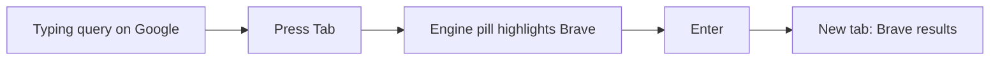
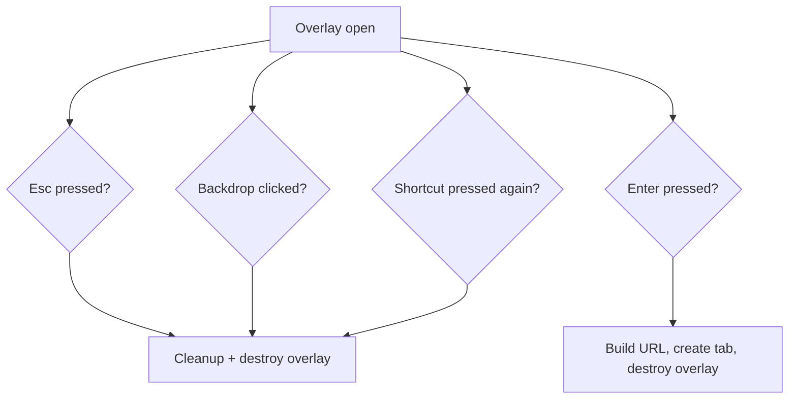
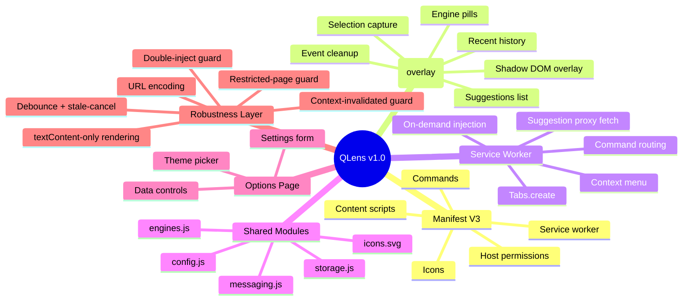
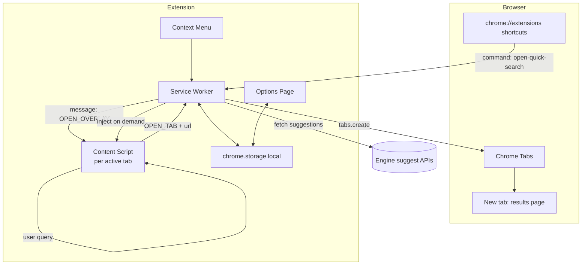

# QLens — Quick Search Overlay for Chrome
## Product Requirements Document (PRD)

---

| Field | Value |
|---|---|
| **Product Name** | QLens |
| **Version** | 1.0.0 |
| **Status** | Ready for Implementation |
| **Date** | 2026-08-14 |
| **Platform** | Google Chrome (Manifest V3) |
| **Pricing** | 100% Free, no ads, no tracking |
| **Audience** | Engineering (the building agent) + QA |

---

# 1. Executive Summary

QLens is a free Chrome extension that puts a **lightning-fast, always-available quick-search overlay** on top of any webpage. Press a keyboard shortcut, a modern glassmorphic search bar appears at the top of the screen. Type a query (or use the text you already selected on the page — no copy-paste), press **Enter**, and results open in your chosen search engine (**Google, Brave, Bing, or DuckDuckGo**) in a new tab.

The overlay is **ephemeral by design**: it exists only while you summon it. It never auto-pops-up when you visit or return to a page. Search → results open → return to the old tab → the page is clean, ready for the next shortcut.

**One sentence:** *"Search anything, anywhere, without leaving your flow — zero copy-paste, zero engine lock-in, zero bloat."*

---

# 2. Vision & Value Proposition

## 2.1 Problem
- Users must leave their current page (or open the new-tab page) to search, breaking their reading/working flow.
- Copying selected text to paste into a search box is friction (2 extra steps per search).
- Users are locked into a single search engine and get no choice at the point of search.
- Existing search extensions either inject persistent bars, clutter the page, collect data, or are ugly.

## 2.2 Solution
- One shortcut → one elegant overlay → one Enter → results in a new tab.
- Selection-aware: highlight text on any site, hit the shortcut, the text is **already in the box**.
- 4 engines switchable mid-query (Google, Brave, Bing, DuckDuckGo) + quick modes (Images, Videos, News, YouTube, Wikipedia).
- Private: 100% local, no backend, no analytics, no account.

## 2.3 Success Criteria (v1.0)
- Overlay opens in **< 80 ms** after shortcut.
- Overlay closes **instantly** on Enter (zero residue when returning to the tab).
- **Zero** auto-popup events in automated + manual testing (the #1 user complaint this product eliminates).
- Works on 100% of normal `http(s)` pages; degrades gracefully on restricted pages (`chrome://`, Web Store, PDF viewer, New Tab).
- No errors in `chrome://extensions` error log during QA.

---

# 3. Goals & Non-Goals

## 3.1 Goals (v1.0)
| # | Goal |
|---|---|
| G1 | Global keyboard shortcut summons the search overlay on any normal webpage |
| G2 | Enter opens the query in a new tab on the selected search engine |
| G3 | 4 engines: Google, Brave, Bing, DuckDuckGo — switchable while typing |
| G4 | Auto-fill with the page's current text selection (no copy-paste) |
| G5 | Overlay is ephemeral — never persists, never auto-shows, zero residue |
| G6 | Modern, elegant, state-of-the-art UI (glassmorphism, spring motion, dark/light) |
| G7 | Fully local & private — no backend, no telemetry, free forever |
| G8 | Production polish: accessibility, edge-case hardening, zero known bugs |

## 3.2 Non-Goals (v1.0)
- Not a replacement for the browser omnibox (different trigger, different use).
- No cross-device sync, no accounts.
- No injection into `chrome://`, Web Store, PDF viewer, or the New Tab page.
- No persistent toolbar UI on pages (only the summoned overlay).
- No analytics, telemetry, or external API keys.

---

# 4. Target Users & Use Cases

## 4.1 Personas
| Persona | Pain | QLens benefit |
|---|---|---|
| **Researcher / Student** | Copy → new tab → paste → search, 20×/day | Select → shortcut → Enter. ~4s saved per search |
| **Developer** | Context-switching out of docs/stack traces | Search errors instantly, in place |
| **Privacy-conscious user** | Default-engine lock-in, tracking | Brave/DDG one keystroke away, zero data leaves device except the search query to the chosen engine |
| **Power user** | Wants shortcuts for everything | Customizable shortcut + engine prefix keys (`g`, `b`, `d`, `k`) |

## 4.2 Core Use Cases
1. **Quick search** — on any site, hit shortcut, type, Enter → new tab with results.
2. **Selection search** — highlight phrase → shortcut → phrase pre-filled → Enter.
3. **Engine switch** — typing a query, hit `Tab`/click engine pill → search runs on that engine.
4. **Direct URL jump** — type `github.com/foo` → QLens opens it directly (smart-URL mode).
5. **Quick mode** — prefix `images: cats` or hit `I` → image results.
6. **Repeat search** — recent-search history, one click re-searches.

---

# 5. Feature Specifications

Priority: **P0** = must ship, **P1** = should ship, **P2** = nice-to-have.

## 5.1 F1 — Global Quick-Search Overlay (P0)

### How it works
- Default shortcut: **`Ctrl+Shift+K`** (rebindable at `chrome://extensions/shortcuts`; `Alt+Space` offered as an alternative preset).
- The shortcut fires the `open-quick-search` **command** in the service worker.
- The service worker asks the active tab's content script to show the overlay. If the content script isn't loaded yet, it injects it on demand and retries (max 2 attempts, 100 ms apart).
- Overlay appears at the **top center** of the viewport as a floating pill, with a subtle dim backdrop.
- The input is focused immediately; typing goes straight to the box.
- **Enter** → build engine URL → `chrome.tabs.create({ url, active: true })` → **overlay is destroyed synchronously before the new tab opens** → user lands on results; returning to the old tab shows a perfectly clean page.
- **Esc** → close overlay (page untouched). Clicking the dim backdrop → close. **Blur-close** (P1, optional setting): closes on focus loss.
- **Shortcut pressed while open** → toggles it closed.

### Ephemerality rules (HARD REQUIREMENTS — the anti-bug core)
| # | Rule |
|---|---|
| R1 | The overlay is **never** shown automatically — on page load, navigation, tab switch, or return. It exists **only** when summoned by the shortcut (or context menu, F12). |
| R2 | On Enter, the overlay DOM is **removed before** the new tab is created. |
| R3 | On close (Esc/backdrop/toggle), the overlay DOM is removed and all listeners cleaned up. |
| R4 | No persistent UI elements remain on the page; injection script is the only residue (a few KB, one message listener). |
| R5 | Content script is **guard-injected** — never double-injected, never erroring on already-loaded pages. |

### Edge cases
- Shortcut pressed on restricted page (`chrome://`, Web Store, PDF, New Tab) → gracefully ignored (no error thrown, no broken overlay). Optionally (P2) show a small toast on the extension's own options page — not required.
- Page is mid-navigation → injection retry logic handles it.
- User holds the shortcut / presses it 10× fast → idempotent toggle, single instance.

## 5.2 F2 — Four Search Engines (P0)

| Engine | Search URL (query = `q`) | Suggestions API | Keyboard prefix |
|---|---|---|---|
| **Google** | `https://www.google.com/search?q=${q}` | `https://suggestqueries.google.com/complete/search?client=firefox&q=${q}` | `g` |
| **Brave** | `https://search.brave.com/search?q=${q}` | none public → fallback to Google suggestions, labeled "via Google" | `b` |
| **Bing** | `https://www.bing.com/search?q=${q}` | `https://api.bing.com/osjson.aspx?query=${q}` | `d`* |
| **DuckDuckGo** | `https://duckduckgo.com/?q=${q}` | `https://duckduckgo.com/ac/?q=${q}` | `k`* |

\* `d` = DuckDuckGo, `k` = keep (Bing) — final mapping is an implementation detail; the point is 4 distinct, memorable prefix keys.

### Engine switching UX
- **`Tab` key** cycles through engines (Google → Brave → Bing → DuckDuckGo) without losing the typed query.
- **Engine pills** at the bottom of the overlay — click to switch instantly.
- **Prefix typing** — type `b cats` → query becomes `cats`, engine switches to Brave (prefix auto-removed).
- **Persistence** — last-used engine per device stored in `chrome.storage.local`; remembered across sessions. Default: Google.

### Guarantees
- Queries are always `encodeURIComponent`-encoded. All engine URLs use `https`.
- Engine definitions live in **one config file** (`engines.js`) — adding a 5th engine later is a 5-line change.

## 5.3 F3 — Selected-Text Auto-Fill (P0)

### How it works
1. User highlights text on a page (e.g., a sentence in an article).
2. User presses the shortcut.
3. Content script reads `window.getSelection()` **at the moment the overlay opens**.
4. The trimmed selection (collapsed whitespace, max 200 chars) is pre-filled into the input with a small **"From selection" chip** so the user knows it auto-filled.
5. Enter → searches the pre-filled text. No copy, no paste, no clipboard.

### Rules
- Only auto-fill if the selection is **in the same document/frame** and is real text (not in an input field or `contenteditable` — those are left alone).
- Selection longer than 200 chars → truncated with `…` (option setting, default 200).
- If the selection is inside a form field, the overlay still opens but empty (user is likely typing there).
- Optional setting (P1): "Auto-copy selection when searching" — writes selection to clipboard using `navigator.clipboard.writeText()` wrapped in try/catch (permission prompt is shown by Chrome automatically).

## 5.4 F4 — Modern Overlay UI (P0)

### Design language — "Liquid Glass" meets minimal
- **Material:** frosted glass (`backdrop-filter: blur(24px) saturate(160%)`), subtle top-light border (`1px rgba(255,255,255,.25)`), soft layered shadow.
- **Shape:** pill / squircle — `border-radius: 20px`, floating at `top: 8vh`, horizontally centered, width `min(680px, 92vw)`.
- **Backdrop:** `rgba(0,0,0,.32)` dim + blur(6px), click-to-close.
- **Colors:** semantic CSS variables; automatic **dark/light** via `prefers-color-scheme`, plus a manual theme toggle in options. Accent color from a curated 6-color palette (indigo default).
- **Typography:** system UI stack (`-apple-system, "Segoe UI", Roboto, Inter, sans-serif`); input 17px; hint text 12px uppercase letter-spaced.
- **Motion:** entrance `scale(0.96) → 1` + `translateY(-8px) → 0` + fade, **200 ms cubic-bezier(0.16, 1, 0.3, 1)**; exit 120 ms fade. **`prefers-reduced-motion: reduce` → all animation disabled.**
- **Layout (top → bottom):** engine logo chip (left) · input (flex-1) · clear (`×`) · engine-cycle hint (`Tab`) · Enter icon (right) — then a second row: engine pills, and below: suggestions / recent history / "From selection" chip.
- **Empty query state:** show "Search the web — Ctrl+Shift+K" placeholder + 4 engine pills + recent searches.
- **Inline SVG logos** for all 4 engines (no external image requests → CSP-safe).

### Accessibility (P0)
- `role="dialog"`, `aria-modal="true"`, `aria-label="Quick search"`.
- Focus trap: Tab cycles within overlay; Esc closes and returns focus to page.
- Input has a visible label (`aria-label`) and visible focus ring (2px accent, `outline-offset`).
- All contrast ratios ≥ WCAG AA; all interactive elements are ≥ 44 px tall.

## 5.5 F5 — Search Suggestions (P1)

- On typing (debounced **250 ms**, stale requests cancelled via request-id), fetch suggestions for the **current engine** (see 5.2 table; Brave falls back to Google, labeled).
- Fetch is done in the **service worker** (avoids content-script CORS/consent edge cases; host permissions granted).
- Suggestions render in the overlay as a list: **↑/↓ + Enter** to use, or click.
- Max 8 suggestions; "search for 'query'" row always first.
- Offline / no response → suggestions silently hidden (never block typing or Enter).

## 5.6 F6 — Recent Searches (P1)

- Last **10 unique** queries stored locally in `chrome.storage.local` (`{ query, engine, ts }`).
- Shown under the input when the field is empty ("Recent" section with clock icons).
- Click a recent → instantly re-search (Enter-equivalent). `×` per item to delete; "Clear all" link.
- History is local-only and never leaves the device.

## 5.7 F7 — Smart Query Handling (P1)

- **URL detection:** query matches `^(https?:\/\/|\w+\.\w{2,}\/?)` → QLens offers **"Go to site"** as the primary action (opens URL in new tab); Enter still does the chosen action.
- **Quotes preserved:** query `"exact phrase"` is passed through untouched.
- **Leading-prefix stripping** (engine prefixes from 5.2) is done before URL construction.
- **Safe display:** query is always rendered via `textContent` / `createElement`, never `innerHTML` (XSS hardening).

## 5.8 F8 — Quick Search Modes (P1)

Special engines available as pills + prefix keys:

| Mode | Prefix | URL |
|---|---|---|
| Images | `images:` | `https://www.google.com/search?tbm=isch&q=` |
| Videos | `videos:` | `https://www.google.com/search?tbm=vid&q=` |
| News | `news:` | `https://news.google.com/search?q=` |
| YouTube | `yt:` | `https://www.youtube.com/results?search_query=` |
| Wikipedia | `wiki:` | `https://en.wikipedia.org/w/index.php?search=` |

Mode pills appear on the second row when the prefix is typed (or always, P2 toggle).

## 5.9 F9 — Options Page (P1)

A clean options page (`options.html`, same design system) with:
- Default engine + engine order (drag pills).
- Theme (System / Light / Dark) + accent color.
- Toggles: blur-close, auto-copy selection, suggestions on/off, show recent history.
- Shortcut reminder + direct link to `chrome://extensions/shortcuts`.
- Data controls: "Clear recent searches", "Reset to defaults".
- Version + privacy line ("100% local — no data leaves your device").

## 5.10 F10 — Right-Click Context Menu (P2)

- Context menu item **"Search with QLens"** on selected text → opens overlay with text pre-filled (or directly searches with default engine — setting).
- Uses `contextMenus` permission + `contexts: ["selection"]`.

## 5.11 F11 — Clipboard Quick Search (P2)

- When the overlay opens and there is no selection, offer the clipboard contents (if text) as a **suggestion chip**: "Use clipboard text". Reads clipboard via `navigator.clipboard.readText()` in a user-gesture context (the shortcut counts); failure → silently skipped.

---

# 6. UX Flows

## 6.1 Primary flow — Quick Search

```mermaid
flowchart LR
    A[User reads page] --> B[Press Ctrl+Shift+K]
    B --> C[Overlay appears, input focused]
    C --> D{Query?}
    D -->|Type new query| E[Press Enter]
    D -->|Text selected on page| F[Text auto-filled] --> E
    E --> G[URL built for active engine]
    G --> H[Tabs.create new tab, active]
    H --> I[Overlay destroyed before tab opens]
    I --> J[User on results page]
    J --> K[Return to old tab: clean page, no overlay]
```



## 6.2 Engine switch mid-query



## 6.3 Close paths



## 6.4 First-run

Shortcut pressed with no selection and empty input → overlay shows placeholder, engine pills, and recent history (empty state) — nothing else. First-time users see the shortcut hint inside the bar.

---

# 7. Technical Architecture (Mind Map)



## 7.1 Component diagram



## 7.2 Source tree (build target)

```
QLens/
├── manifest.json
├── src/
│   ├── background/
│   │   └── service-worker.js      # commands, injection, tabs, suggestions proxy
│   ├── content/
│   │   ├── overlay.js             # shadow DOM host + lifecycle
│   │   ├── overlay.css            # design tokens + glass styles
│   │   ├── injector.js            # idempotent guard + message receiver
│   │   └── selection.js           # selection capture helpers
│   ├── shared/
│   │   ├── config.js              # constants, defaults, version
│   │   ├── engines.js             # ALL engine definitions + URL builders
│   │   ├── storage.js             # typed storage helpers w/ defaults
│   │   ├── messaging.js           # protocol constants + send helpers
│   │   └── logos.js               # inline SVG engine logos
│   ├── options/
│   │   ├── options.html
│   │   ├── options.css
│   │   └── options.js
│   └── icons/
│       ├── icon16.png  icon32.png
│       ├── icon48.png  icon128.png
│       └── icon.svg
├── tests/
│   ├── manual-checklist.md
│   └── e2e/ (optional puppeteer smoke)
├── PRD.md                       # this document
└── CHANGELOG.md
```

## 7.3 Message protocol (content ↔ service worker)

| Message | Direction | Payload | Meaning |
|---|---|---|---|
| `OPEN_OVERLAY` | SW → CS | `{ selection }` (optional) | Show overlay, focus input, pre-fill selection |
| `CLOSE_OVERLAY` | SW → CS | — | Destroy overlay (toggle path) |
| `OPEN_TAB` | CS → SW | `{ url }` | Open URL in new active tab; CS destroys overlay immediately after send |
| `FETCH_SUGGESTIONS` | CS → SW | `{ engine, query }` | Proxy suggestions request |
| `SUGGESTIONS_RESULT` | SW → CS | `{ id, results }` | Suggestions response |
| `OVERLAY_READY` | CS → SW | `{ tabId }` | Confirms receiver exists (prevents double-injection) |

All messages validated: `sender.id === chrome.runtime.id`, plus an incrementing request id for suggestions (stale results dropped).

## 7.4 Data model (`chrome.storage.local`)

```jsonc
{
  "settings": {
    "defaultEngine": "google",
    "engineOrder": ["google", "brave", "bing", "duckduckgo"],
    "theme": "system",          // "system" | "light" | "dark"
    "accent": "indigo",
    "blurClose": false,
    "autoCopySelection": false,
    "suggestions": true,
    "maxSelection": 200
  },
  "lastEngine": "google",
  "recent": [
    { "query": "flutter liquid glass", "engine": "google", "ts": 1723600000000 }
  ]
}
```

- `chrome.storage.sync` for `settings` (so choices follow the user's Google account — optional, P2). Everything else stays in `local`.

---

# 8. Tech Stack & Skills

## 8.1 Recommended stack
| Layer | Choice | Why |
|---|---|---|
| Extension API | **Manifest V3** (Chrome 109+) | Current standard, service workers, better security, CWS-required |
| Language | **Vanilla JavaScript (ES2022)** | Zero build step, no bundler bugs, no dependency CVEs, CSP-safe |
| Type safety (optional) | **JSDoc + checkJs** or TypeScript w/ Vite | If TS: Vite `lib` mode with `vite-plugin-web-extension` — choose ONE, don't mix |
| UI | **Shadow DOM** (open/closed via attach) + Web Components | Perfect CSS isolation from any webpage, no style bleed, no page breaking |
| Styling | **CSS custom properties + `prefers-color-scheme`** | Themes without JS, tiny footprint |
| Icons | Inline **SVG** + PNG raster for manifest | Zero network requests, CSP-safe |
| Storage | `chrome.storage.local/sync` | Built-in, async, quota-managed |
| Testing | Manual matrix + **Playwright/puppeteer with a test profile** | Catches injection/navigation bugs automatically |
| Lint | ESLint (`eslint-config-chrome-extension` style) | Catches scope/async bugs |

**Deliberate exclusions:** no React/Vue, no bundler required, no external UI kits, no remote code, no eval — every exclusion removes a class of bugs and review friction.

## 8.2 Skills / capabilities to use when building
| Skill | Where it applies |
|---|---|
| `frontend-design` / `impeccable` | Overlay + options UI design polish |
| `fixing-accessibility` | ARIA, focus trap, contrast audit |
| `fixing-motion-performance` | Animation audit, reduced-motion, compositor-only props |
| `playwright-cli` | Automated smoke tests in a clean Chrome profile |
| `master-planner` | Keep the build phased (Section 9) and verify each phase |

---

# 9. Backend Strategy

## 9.1 v1.0: **No backend. Period.**
- Search is a pure URL build: `https://<engine>/search?q=<encoded>`. No proxy, no API keys, no servers.
- Suggestions use the engines' **public suggestion endpoints** directly (host permissions handle CORS).
- Recent history and settings live in `chrome.storage` (local to the device / Chrome account).
- **Privacy model:** the only data that ever leaves the device is the query the user typed, sent directly to the engine they chose — exactly like typing in the omnibox. No QLens servers see anything.

## 9.2 If a backend ever becomes necessary (NOT in v1)
- **Reason candidates:** cross-device sync (prefer `chrome.storage.sync` first — free), AI answer summaries, image reverse search, privacy-preserving suggestions.
- **Recommended shape if needed:** serverless (Cloudflare Workers / Vercel edge) with no datastore or ephemeral datastore; POST `{ query, engine }` → `{ suggestions[] }`; rate-limited by IP hash; **no logs of query content** (log only aggregate counts); a public privacy policy at a static URL. Keep the extension's client unchanged behind `messaging.js`.

---

# 10. Security & Privacy

## 10.1 Permissions (minimal set, each justified)
| Permission | Justification |
|---|---|
| `commands` (manifest key, not permission) | Keyboard shortcut |
| `scripting` | On-demand content-script injection |
| `storage` | Settings + recent history |
| `contextMenus` (P2 feature) | Right-click search |
| `host_permissions: ["http://*/*","https://*/*"]` | Inject on any normal page + fetch suggestion endpoints |

**Not used:** `tabs` (reading tabs is unnecessary — `chrome.tabs.create` needs no permission; only `activeTab`-free messaging target), `cookies`, `webRequest`, history access, `clipboardRead` (read is user-gesture-only).

## 10.2 Hardening rules
1. **Never** render user input via `innerHTML`/`insertAdjacentHTML` — always `textContent` / DOM APIs.
2. All search URLs built with `URL` constructor + `encodeURIComponent`; engine list is a hardcoded allowlist (no user-supplied host can be substituted).
3. Validate every incoming message: `sender.id === chrome.runtime.id` and payload shape.
4. CSP: MV3 default (`script-src 'self'`) — enforced by using no eval/inline scripts.
5. Content script styles live in Shadow DOM → cannot be read/corrupted by the page.
6. Suggestions fetch failures are swallowed — no error surfaces, no crash.
7. Clipboard read (P2) only inside the shortcut user-gesture, failures silently skipped.

---

# 11. Robustness & Error-Handling Matrix

Every row = a test case that **must pass** before shipping.

| # | Scenario | Expected behavior | Implementation guard |
|---|---|---|---|
| E1 | Shortcut on `chrome://extensions`, Web Store, New Tab, PDF viewer | Nothing happens; no error log | Check `tab.url` scheme before messaging; wrap in try/catch |
| E2 | Shortcut before content script loaded (fresh page) | Overlay still opens | Service worker `chrome.scripting.executeScript` injection + 2 retries with 100 ms backoff |
| E3 | Rapid shortcut ×10 | One overlay; toggles open/closed | Idempotent command; `OVERLAY_READY` handshake; open-state flag |
| E4 | Double injection after extension reload (`chrome.runtime` invalidated) | No crash; fresh script registers once | `window.__QLENS_LOADED__` guard + `runtime.onMessage` try/catch on `sender.id` |
| E5 | SPA navigation (Gmail, YouTube, React apps) | Overlay unaffected; no duplicate | Content script survives SPA nav; overlay always in-memory only |
| E6 | Full page reload while overlay open | Overlay gone, no error | DOM unload destroys it naturally; no `beforeunload` leaks |
| E7 | Selection in an input/textarea | Overlay opens **empty** | Selection source check (ignore editable contexts) |
| E8 | Selection of 5,000 chars | Truncated to 200 + `…` | `maxSelection` cap in `selection.js` |
| E9 | Offline / suggestion API down | Suggestions hidden; Enter still works | Silent catch + timeout (1.5 s) + request-id stale-drop |
| E10 | Query `javascript:alert(1)` or `data:` URI | Never navigated | URL allowlist (`http`/`https` only) in smart-URL logic |
| E11 | Emoji / non-Latin / quotes in query | Encoded correctly, engine handles | `encodeURIComponent` everywhere |
| E12 | Page with heavy CSS (z-index wars) | Overlay always on top | `position: fixed`, `z-index: 2147483647`, Shadow DOM host styles reset |
| E13 | Extension disabled mid-session | Page has zero residue | All mutations inside shadow root; destroyed on close |
| E14 | Storage corrupted / unparsable | Defaults used | `storage.js` validate-and-fallback pattern |
| E15 | User rebinds shortcut to something used by Chrome | Chrome's UI warns on conflict; QLens still works with its fallback | Documented in options page; command API handles conflicts natively |
| E16 | Multiple windows / multiple tabs | Overlay only in the active tab; new tab opens in active window | `tabs.create` inherits window; injection targets `activeTab` of focused window |

---

# 12. Bug-Prevention Playbook (Implementation Guide)

## 12.1 Golden rules (all 15, non-negotiable)
1. **No `innerHTML` with user data — ever.** Use `textContent` and `createElement`.
2. **Build all URLs through one function** (`buildSearchUrl(engine, query)`) that URL-encodes and validates scheme.
3. **Guard injection** with a `window` flag; guard messages with `sender.id`.
4. **Never auto-show the overlay** — it only appears on explicit command. Add a dev-time assertion that no code path calls `show()` on load/navigation.
5. **Destroy the overlay synchronously before `tabs.create`** — never after (this kills the "residue on return" bug class).
6. **Wrap every `chrome.*` call** in try/catch (MV3 async APIs throw on restricted contexts).
7. **All fetch calls** get: `AbortController` timeout (1.5 s) + request-id stale-drop.
8. **Shadow DOM + `all: initial` on host** — the page cannot affect the overlay, and the overlay cannot leak styles.
9. **Storage reads always have defaults** — `storage.js` returns config objects, never raw.
10. **No inline event handlers** (`onclick=` in HTML) — violates CSP and complicates cleanup.
11. **Cleanup on close:** remove all listeners, cancel pending fetches, null references (prevent ghost timers).
12. **Debounce suggestions (250 ms)** — never fire a fetch per keystroke.
13. **Test restricted pages in the manual matrix** (E1) before every release.
14. **Pin `minimum_chrome_version`** and test on Chrome 109 and latest.
15. **Keep modules tiny and pure** — `engines.js` and `messaging.js` contain zero DOM logic; unit-testable in isolation.

## 12.2 Build sequence (10 phases, each verifiable)

| Phase | Build | Verify |
|---|---|---|
| 1 | `manifest.json` (commands, permissions, icons) + all PNG icons | Loads in `chrome://extensions`, zero errors |
| 2 | Service worker: log the `open-quick-search` command | Press shortcut → log appears |
| 3 | Content script + injector with `OVERLAY_READY` handshake | `chrome.scripting.executeScript` logs on fresh page; no double-inject on refresh |
| 4 | Static overlay UI in Shadow DOM (F4 layout, glass style) | Opens via shortcut, looks right, Esc closes, no residue after reload |
| 5 | Input + Enter → `OPEN_TAB` → `tabs.create` (Google) | New active tab with results; **return to old tab → clean page** |
| 6 | Engine pills + Tab cycle + prefix keys (F2, `engines.js`) | All 4 engines + persistence of last engine |
| 7 | Selection capture + "From selection" chip (F3) | Select → shortcut → pre-filled |
| 8 | Suggestions + recent history + smart-URL (F5, F6, F7) | Debounce works; offline hides suggestions; `github.com/x` offers "Go to site" |
| 9 | Options page + theming + context menu (F9, F10) | Settings persist; theme applies; right-click works |
| 10 | Full QA: manual matrix (Section 13) + ESLint clean + package | All E1–E16 pass; zip built; no console errors |

---

# 13. Testing & QA Plan

## 13.1 Manual test matrix (must run on Windows + macOS, Chrome 109 + latest)
1. Section 11 matrix **E1–E16** — every row, documented result.
2. Visual QA on 6 diverse sites: Wikipedia (long text), YouTube (SPA), GitHub (complex layout), Gmail (SPA + iframes), a shopping site (heavy CSS), `data:`/file page (should no-op).
3. Motion check with OS-level "reduce motion" on and off.
4. Dark/light/3 accent themes — contrast + legibility.
5. Engine sanity: one real query per engine, verify results page & suggestion behavior.
6. Selection tests: plain text, inside input, 5,000 chars, emoji, code snippet.
7. Persistence: last engine, recent history, settings survive browser restart.
8. No-residue test: search → return to tab → screenshot shows clean page (this is the product's promise).

## 13.2 Automated smoke (optional but recommended)
Puppeteer with a fresh Chrome profile + the unpacked extension (Chrome headless supports extensions with `--load-extension`):
- Load extension → simulate command → overlay visible.
- Type + Enter → new tab URL matches engine template.
- Toggle ×5 → single overlay instance.
- Restricted page (`chrome://version`) → no throw, no overlay.

## 13.3 Definition of Done
- ESLint passes with zero errors. No console errors across the matrix.
- E1–E16 all green. No-residue test green on all 6 test sites.
- Packed `QLens-v1.0.0.zip` builds clean and installs from `.crx`-equivalent unpacked folder.

---

# 14. Release & Store Listing

## 14.1 Packaging
- Icons: 16/32/48/128 PNG (also used in store). Semver + `CHANGELOG.md`.
- Zip the source (minus tests/node_modules) as the CWS upload.

## 14.2 Chrome Web Store assets
| Asset | Content |
|---|---|
| Name | **QLens — Quick Search Overlay** |
| Short description | Search Google, Brave, Bing, or DuckDuckGo from any page with one shortcut. No copy-paste needed. |
| Full description | (From PRD §1 + feature list; highlight: 4 engines, selected-text search, ephemeral bar, 100% private, free) |
| Screenshots | 5: overlay light, overlay dark, selection auto-fill, engine pills, options page |
| Privacy | "No data collected" — single-purpose extension + privacy policy page |

## 14.3 Distribution
- Free, no ads, no premium tier. Single-purpose, minimal permissions → passes CWS review with no special justifications needed.

---

# 15. Success Metrics

| Metric | Target |
|---|---|
| Time from shortcut → overlay visible | < 80 ms |
| Time from Enter → results tab | < 300 ms |
| Auto-popup incidents | 0 |
| CWS rating after 60 days | ≥ 4.5 |
| Weekly searches per install | ≥ 5 |

---

# 16. Roadmap

| Version | Scope |
|---|---|
| **v1.0** (this PRD) | F1–F10: overlay, 4 engines, selection fill, suggestions, history, smart URL, options, context menu |
| v1.1 | F11 clipboard chip, blur-close, more accents, `chrome.storage.sync` settings |
| v1.2 | Image search preview thumbnails, engine plugins (Ecosia, Startpage, Yandex), quick-mode pills always visible |
| v1.3 | Firefox/Edge port (WebExtensions API — same code, browser-agnostic touches), optional self-hosted suggestions server |

---

# 17. Assumptions & Open Questions

| # | Item | Status |
|---|---|---|
| A1 | **4th engine = DuckDuckGo** ("the group" in the brief is ambiguous; DDG is the standard privacy choice and has a suggestion endpoint) | Assumed — swap is a 5-line `engines.js` change |
| A2 | Default shortcut **`Ctrl+Shift+K`** (rebindable; `Alt+Space` conflicts with Windows' window menu, so not default) | Assumed |
| A3 | Overlay is an in-page floating bar (not browser UI) — matches "top of the webpage" requirement | Confirmed by brief |
| A4 | Engine persistence = last used per device | Assumed |
| Q1 | Should right-click search open overlay (pre-filled) or search directly? | Default: overlay; toggle in options (F10) |
| Q2 | Should suggestions be on by default? | Default: on (they're fetch-light and silent on failure) |
| Q3 | Tagline preference: *"Search anything, anywhere"* vs *"The fastest way from thought to search"*? | Cosmetic; changeable later |

---

# 18. Appendix — Key Implementation Snippets (reference)

## 18.1 Manifest skeleton (MV3)

```jsonc
{
  "manifest_version": 3,
  "name": "QLens — Quick Search Overlay",
  "version": "1.0.0",
  "description": "Search Google, Brave, Bing, or DuckDuckGo from any page with one shortcut.",
  "minimum_chrome_version": "109",
  "permissions": ["scripting", "storage", "contextMenus"],
  "host_permissions": ["http://*/*", "https://*/*"],
  "background": { "service_worker": "src/background/service-worker.js" },
  "content_scripts": [],
  "commands": {
    "open-quick-search": {
      "suggested_key": { "default": "Ctrl+Shift+K", "mac": "MacCtrl+Shift+K" },
      "description": "Open QLens quick search"
    }
  },
  "options_page": "src/options/options.html",
  "icons": { "16": "src/icons/icon16.png", "32": "src/icons/icon32.png",
             "48": "src/icons/icon48.png", "128": "src/icons/icon128.png" }
}
```

## 18.2 Safe URL builder (single source of truth)

```js
export function buildSearchUrl(engineId, query) {
  const engine = ENGINES[engineId] ?? ENGINES.default;
  const q = encodeURIComponent(query.trim());
  const url = new URL(engine.template + q, engine.base);
  if (!/^https?:$/.test(url.protocol)) return null; // hard allowlist
  return url.href;
}
```

## 18.3 Injector guard (idempotent)

```js
if (!window.__QLENS_INJECTED__) {
  window.__QLENS_INJECTED__ = true;
  chrome.runtime.onMessage.addListener((msg, sender, sendResponse) => {
    if (sender.id !== chrome.runtime.id) return;
    if (msg.type === MESSAGES.OPEN_OVERLAY) handleOpen(msg.payload);
    if (msg.type === MESSAGES.CLOSE_OVERLAY) handleClose();
    sendResponse({ type: MESSAGES.OVERLAY_READY });
  });
}
```

## 18.4 Ephemeral close-before-navigate (the no-residue guarantee)

```js
// content script, on Enter:
chrome.runtime.sendMessage({ type: MESSAGES.OPEN_TAB, payload: { url } });
destroyOverlay(); // synchronous DOM removal BEFORE the new tab activates
```

---

# 19. Conclusion

QLens is a small-scope, high-polish product: one shortcut, one overlay, four engines, zero backend, zero residue. The architecture above is deliberately dependency-free so the building agent can implement it phase-by-phase with a verifiable check after each step, hitting **"no known bugs"** by following Section 11 (matrix) and Section 12 (playbook) religiously.

**This PRD is the source of truth. Every feature, rule, and test case in it is in-scope for v1.0; anything not listed here is out of scope.**
